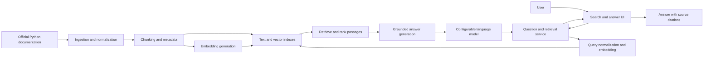

# Python Documentation Assistant — Architecture

**Status:** Initial demo proposal  
**Project boundary:** This is a standalone project under `python-assistant/`. It does not share application code or runtime state with the parent enterprise RAG assistant.

## 1. Purpose

Build a demo where a user can ask questions about Python and receive a concise, grounded answer with links to the official Python documentation pages used to create it.

For the first version, “Python” means the selected version of the **official Python language and standard-library documentation**. It does not yet include third-party package documentation, arbitrary websites, or execution of user-provided code.

## 2. Goals and non-goals

### Goals

- Search Python documentation using natural-language questions and keywords.
- Return an answer supported by retrieved documentation passages.
- Show citations with page titles and links to the source documentation.
- Make it possible to refresh the corpus and change the Python documentation version.
- Keep components small enough to run locally as a demo.

### Non-goals for the first demo

- Searching all Python content on the public internet.
- Running submitted Python code or installing packages.
- User accounts, company permissions, or multi-tenant isolation.
- Production-scale availability, distributed indexing, or a full admin console.

## 3. Proposed high-level architecture

The ingestion/indexing path runs separately from the interactive question path. Rebuilding the index should not require changing the user interface.

## 4. Main components

### Documentation source

- Use the official Python documentation as the initial corpus.
- Select and record one stable documentation version for each index build.
- Preserve the original URL, page title, section heading, version, and retrieval timestamp as metadata.
- Before downloading or redistributing documentation, verify the current source license and terms. Keep attribution and source links with the indexed content.

### Ingestion and indexing

1. Fetch or import only approved documentation pages.
2. Convert pages to clean text while retaining headings and source URLs.
3. Split text into section-aware chunks; avoid breaking code blocks where practical.
4. Store chunk text and metadata in a persistent local index.
5. Generate embeddings and enable semantic retrieval. Add keyword search or hybrid retrieval if testing shows that exact identifiers and API names are missed.
6. Record the documentation version and ingestion configuration so the index can be reproduced.

### Question and retrieval service

- Accept the user's question and optional documentation-version filter.
- Retrieve a small set of relevant chunks using semantic and, if enabled, keyword search.
- Rank results and pass only the strongest passages to answer generation.
- Ask the model to answer only from supplied sources, cite claims, and say when the sources do not contain enough information.
- Return the answer and citation metadata to the UI.

### User interface

A small local web UI should provide:

- A question input and submit action.
- A readable answer area.
- Clickable citations displaying page title and section.
- A visible “not found in the indexed documentation” response when evidence is weak.
- Optional feedback controls for useful/not useful answers.

### Model and storage adapters

Keep the language-model and vector-store interfaces behind small adapters. This allows the demo to switch providers or local implementations without changing retrieval and UI logic. Credentials must come from environment variables or a local, ignored secrets file; never commit secrets.

## 5. Query flow

1. The user submits a Python question.
2. The service embeds and searches the question against the selected corpus.
3. Retrieval returns relevant passages and source metadata.
4. The service checks whether the evidence is sufficient to answer.
5. If sufficient, the model generates a concise answer grounded in the passages and includes citations. Otherwise, it explains that the indexed docs do not provide a reliable answer.
6. The UI renders the answer and links to the source pages.

## 6. Suggested demo technology choices

These are starting recommendations, not requirements:

- **Language:** Python.
- **UI:** Streamlit for a quick local demo; consider a separate frontend only if the product needs it.
- **Ingestion:** A repeatable Python command/script, independent of the UI.
- **Retrieval:** A persistent local vector store plus metadata filtering; add BM25/keyword retrieval for exact Python symbols.
- **Embeddings and answer model:** Provider adapters, selected based on cost, data-handling requirements, and availability. Keep model names and credentials in configuration, not source code.
- **Initial runtime:** Local development with a small, versioned documentation corpus.

Avoid locking the project to a particular hosted model or vector database until the first retrieval tests establish the needs.

## 7. Quality, safety, and operational requirements

- **Grounding:** Answers must be based on retrieved documentation; citations should resolve to the original page.
- **Abstention:** Do not invent an answer when retrieval evidence is insufficient.
- **Freshness:** Store the docs version and provide a repeatable re-index process.
- **Privacy:** Do not log secrets or unnecessary user content. Use a provider approved for the data sent to it.
- **Prompt injection:** Treat retrieved page text as reference material, not as instructions that can override system behavior.
- **Observability:** During the demo, record retrieval latency, answer latency, source IDs, and errors without storing sensitive content.
- **Reproducibility:** Keep configuration and corpus version information with each index build.

## 8. Evaluation plan

Before adding more document sources, create a small question set covering:

- Core syntax and language behavior.
- Standard-library modules and API usage.
- Exact symbol lookups (for example, function or class names).
- Questions whose answers are not present in the selected docs.

For each test, check retrieval relevance, factual correctness, citation correctness, appropriate abstention, and response time. Fix corpus parsing and retrieval issues before tuning prompts or changing models.

## 9. Delivery phases

1. **Corpus proof:** Ingest a small set of official Python documentation pages and verify headings, links, and metadata.
2. **Search MVP:** Add retrieval and display the most relevant source passages with links.
3. **Grounded answers:** Add answer generation, citations, and abstention behavior.
4. **Evaluation and refresh:** Add a repeatable test set, feedback capture, and documentation-version refresh.
5. **Expansion:** Consider third-party Python package docs or other trusted sources only after source-specific licensing and ingestion are addressed.

## 10. Initial acceptance criteria

- A user can ask a natural-language question about the indexed official Python documentation.
- The response includes at least one valid source citation when it makes a documentation-based claim.
- Unsupported questions receive a clear limitation response rather than a fabricated answer.
- The source version and URLs can be identified for every indexed passage.
- A developer can rebuild the index from the documented ingestion process.
